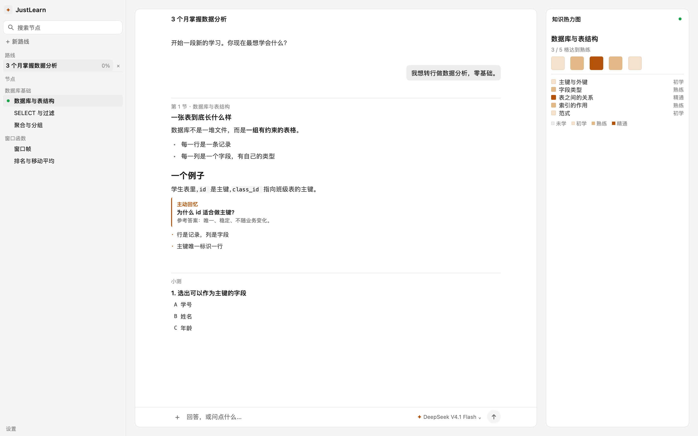
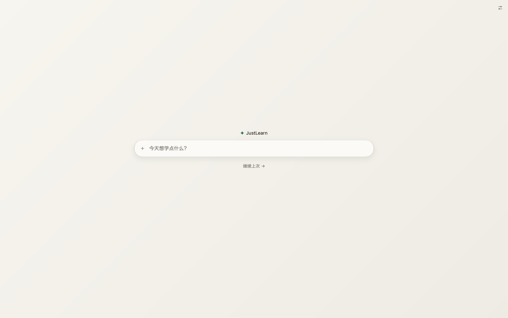
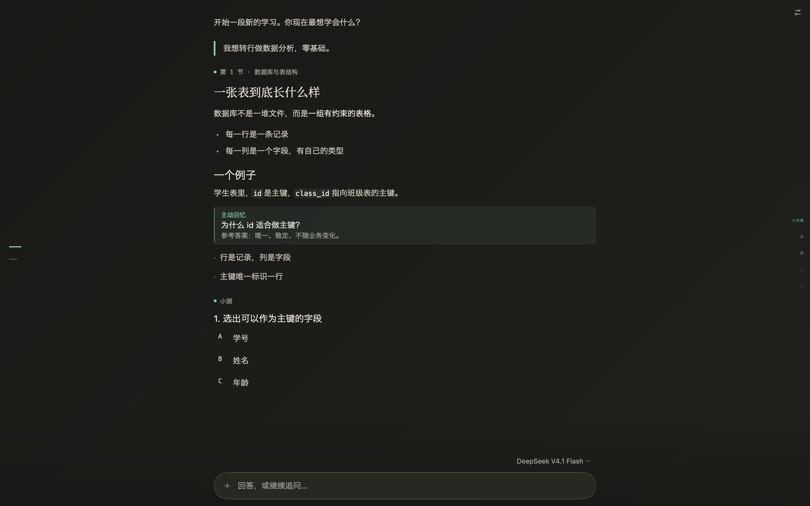
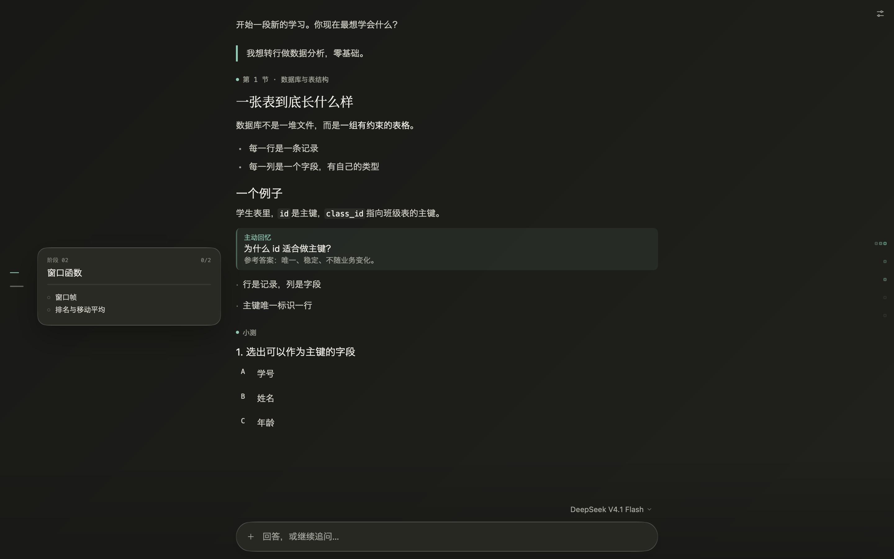
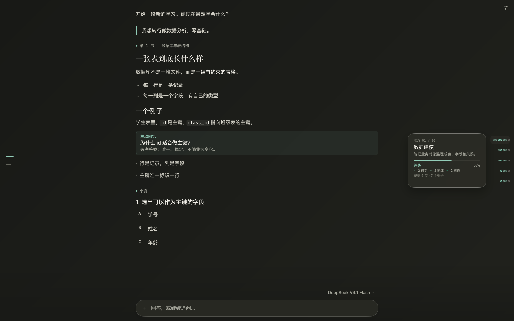
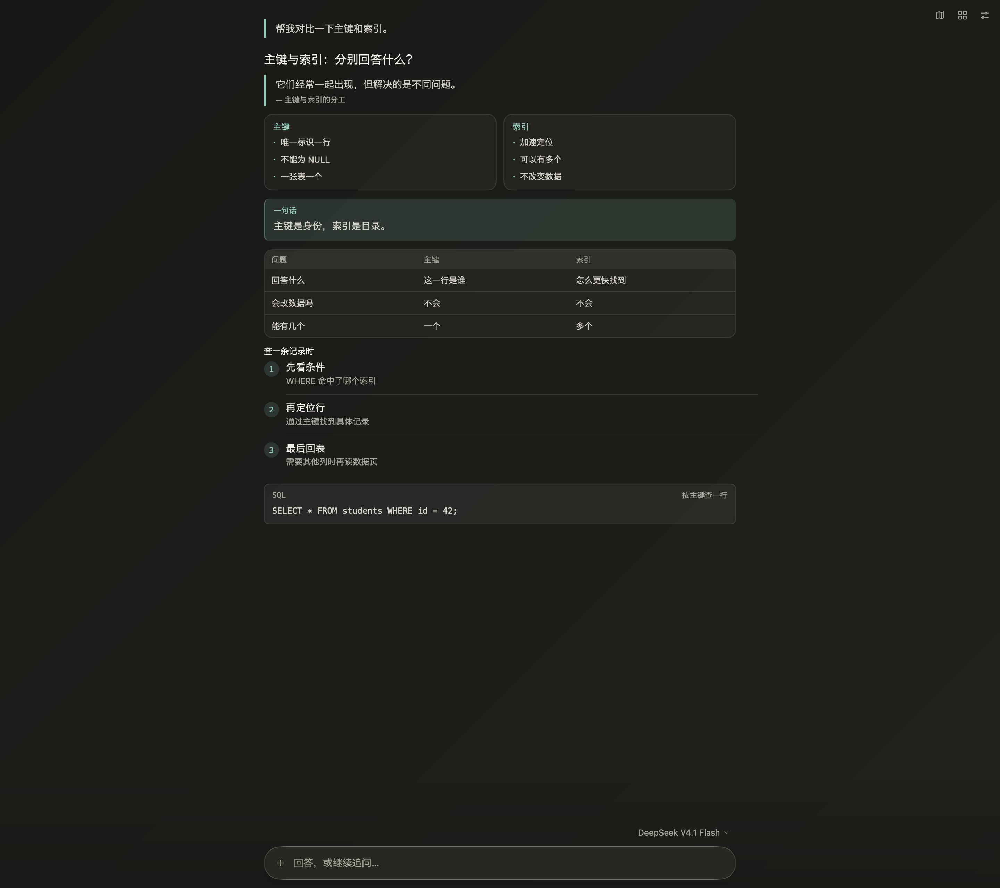
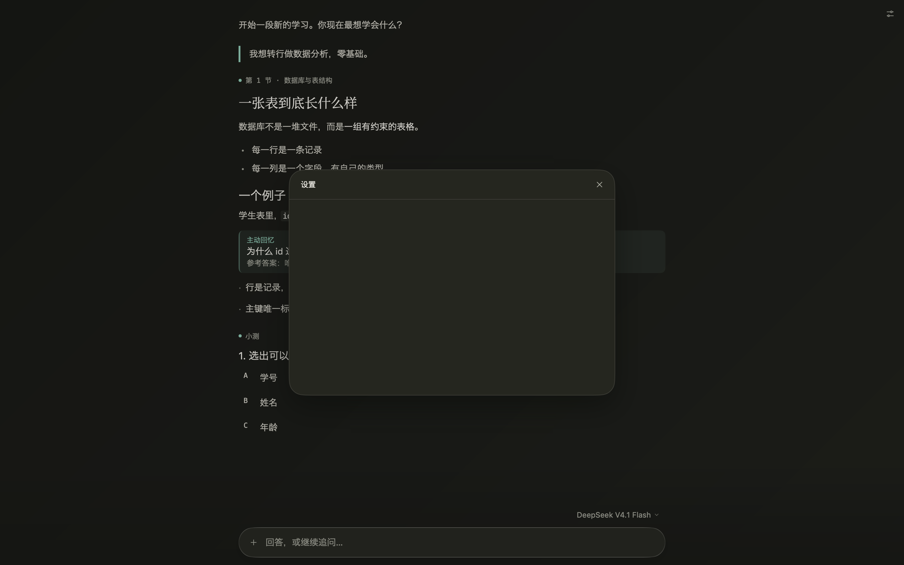
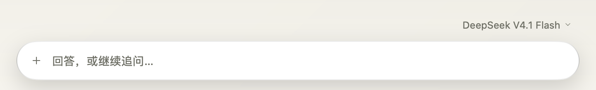

# JustLearn

JustLearn 是一个原生桌面的 AI 私人教师：打开就是一个居中的输入框，发送后整个窗口变成一段持续的学习对话。聊天页左侧是一条极窄的路线预览轨，右侧是一张默认退后的能力画像；设置收在右上角一个极小的按钮里。

界面用 Go + [MyGo](https://mygo.egoist.dev) 绘制，不使用 webview。视觉是暖纸 / 深墨底色、玉色强调和衬线课文标题；输入框使用 MyGo `plugins/glass` 的真实 Liquid Glass，其余大面积保持安静。支持跟随系统、浅色和深色。数据保存在本机 SQLite，模型通过任意 OpenAI 兼容接口调用。

[官网](https://justdoswift.github.io/justlearn/) · [设计规范](DESIGN.md)





## 功能

- **一屏一个焦点**：首页没有标题栏、侧栏和功能说明，只有一个小标志、居中的输入框和一条“继续上次”。打开就能开始学。
- **全窗聊天**：发送后输入框飞到窗口底部，学习内容占据整块画布；没有常驻导航，读到哪儿就是哪儿。
- **路线预览轨**：聊天页左侧一条 34px 宽的无底刻度轨，每个阶段一根刻度；越靠近当前或悬停阶段越长，形成小幅金字塔。悬停时右侧浮出该阶段的进度和节点预览，不推动正文，也不改变输入框位置。
- **能力画像**：聊天页右侧固定 4–6 个跨节点的能力维度，每项能力只显示一排汇总整条路线的微型热力块；能力名、说明、掌握分布和覆盖范围都收在悬浮卡里。默认退到半透明，悬停恢复；它不是路线节点的副本。
- **极小入口**：右上角只剩设置一个 28px 图标；设置仍是空白入口。路线图已经没有独立按钮和面板。
- **克制的 Liquid Glass**：输入框用不透明纸色 tint 的玻璃，保留边缘和细腻高光但不泛白光；发送 / 停止按钮使用真实玻璃材质。大面板是暖色实色纸面加细描边，不做整窗磨砂。
- **暖纸与深墨**：浅色是带一点阳光的纸白，深色是偏暖的墨黑；玉色只用于强调、焦点和“主动回忆”，绿色 / 红色只表达答对 / 答错。
- **编辑感排版**：界面用 SF Pro Text + Hiragino Sans GB（中文），课文标题用 Source Han Serif / Songti SC；正文 14px、行高 1.7，所有界面字重最高 400，不用粗体做层级。
- **聊天式教学**：一次只问一个问题，讲一小段、问一个检查问题，答完再继续；不会一次倒完整节课。
- **长代码不占屏**：代码块默认只显示 9 行，带语言标签，可展开 / 收起；小测选项统一为一条行，长 SQL 只换成等宽字体，不再把三段 SQL 挤成正文。
- **生成式画布**：模型可以输出受控的原生 block，而不是 HTML：文字、引用、提示框、步骤、表格、双栏对比、代码、可翻面的记忆卡和柱状图。块沿用阅读列、字体和纸面材质，最多 6 块，交互由客户端控制。
- **路线与能力分离**：模型先定义 4–6 个跨节点的能力维度，再为每个节点的知识格子绑定能力。右侧能力画像按能力汇总整条路线的证据，节点完成不等于能力掌握。
- **要点卡可选**：只有用户通过几轮问答弄懂一个侧面后，才生成一张 200–300 字的要点卡。
- **小测**：一次一题，答题后行内给出正确答案与解析，并把真实回答写回对应能力格子的证据。
- **模型选择**：聊天页输入框右上方显示当前模型，点开浮层可切换；`/models` 可用时自动列出服务端模型。
- **继续上次与新建**：首页的“继续上次”回到当前对话；`⌘N` 新建学习路线，`⌘⇧H` 回到首页。
- **导入文本**：输入框左侧 `+` 可导入 `.txt` / `.md`，把内容放进草稿继续编辑。
- **设置**：右上角“设置”目前是空白占位；完整设置页从菜单「文件 → 设置…」（`⌘,`）打开，首次没有 API Key 时也会自动进入模型配置。
- **原生与更新**：Liquid Glass 窗口材质、SQLite 本地数据、Key 存系统钥匙串；从 GitHub Release 检查签名更新。

聊天页：



路线预览轨（阶段刻度、进度、节点状态）：



能力画像（整条路线、悬停能力卡）：



生成式画布（由模型输出原生 block）：



设置入口目前保留为空白面板：



输入框：



## 当前范围

路线图已接入真实数据：阶段、节点和完成状态都来自 SQLite，展示为左侧预览轨。右侧能力画像只读取跨节点的能力维度，由知识格子的真实证据聚合；设置面板仍是空白外壳。完整设置页只作为模型配置的兜底入口，不是主界面。

## 运行

要求 Go 1.27+（MyGo 使用 Go 1.27.3 工具链），macOS 12+ / Windows 10+ / Linux（WebKitGTK 4.1）。Liquid Glass 的窗口材质在 macOS 26+ 生效；旧系统仍可使用应用内的玻璃组件。

```bash
git clone https://github.com/justdoswift/justlearn.git
cd justlearn
cp .env.example .env        # 填入 PI_BASE_URL / PI_MODEL / PI_API_KEY
cd desktop
go tool mygo dev
```

开发版以无窗口方式启动，热重载不会抢前台；点 Dock 里的「JustLearn Dev」，或用菜单「文件 → 显示窗口」（`⌘O`）打开。

首次运行也可以在完整设置页里填 Base URL、模型和 API Key，Key 会存进系统钥匙串；开发时用根目录 `.env` 更方便。

## 打包

```bash
cd desktop
go tool mygo build
```

产物在 `desktop/build/<os>-<arch>/`。macOS 会生成 `.app` 和 `.dmg`。

## 发布与更新

正式包用 Developer ID 签名、公证，并从 GitHub Release 分发；安装后的副本通过 MyGo 的签名更新机制自动检查新版本。

首次发布前，确认 `desktop/mygo.json` 里的 `macos.signingIdentity` 与 `macos.notarize.keychainProfile` 对应本机的 Developer ID 和公证凭据。更新签名密钥单独生成，私钥不要进仓库：

```bash
cd desktop
go tool mygo keygen -o "$HOME/Library/Application Support/mygo/update-keys/justlearn"
```

把输出的 `publicKey` 填进 `desktop/mygo.json` 的 `updates`，私钥保存在本机。发布时先提升 `version` 并写 `CHANGELOG.md` 里对应的 `## <version>` 段，提交后从仓库根目录运行：

```bash
scripts/release.sh
```

脚本会构建 `darwin/universal`、签名、公证、生成更新归档与 manifest，并用 `-upload` 上传到该版本的 GitHub **draft** release。检查草稿后发布：

```bash
gh release edit v0.0.1 --draft=false
```

也可以 `PUBLISH=1 scripts/release.sh` 在构建上传后直接发布。更新私钥默认从 `~/Library/Application Support/mygo/update-keys/justlearn/mygo-update.key` 读取，可用 `MYGO_UPDATER_PRIVATE_KEY_FILE` 或 `MYGO_UPDATER_PRIVATE_KEY` 覆盖。

## 模型

任何 OpenAI 兼容的 `/chat/completions` 服务都可以。默认读取：

- `PI_BASE_URL`
- `PI_MODEL`
- `PI_API_KEY`

模型列表接口是可选的；服务不提供 `/models` 时，输入框右上方的模型浮层会保留当前模型和「模型设置…」。应用内的模型选择会写入本地设置，并优先于环境变量。

## 结构

```
desktop/
  main.go            应用入口、窗口、菜单
  app.go             状态、刷新、模型与文本导入
  toolbar.go         右上角设置入口
  panels.go          左侧路线预览轨、设置空白面板
  heatmap.go         右侧能力画像、能力聚合与详情卡
  chat.go            首页输入、消息、课文、小测、输入区、模型浮层
  canvas.go          生成式画布：引用、表格、对比、步骤、代码、记忆卡、柱状图
  settings.go        完整设置页（菜单 / 首次运行的兜底）
  icons.go           线性图标与图标按钮
  theme.go           调色板、字体、Liquid Glass、主题
  internal/genui     画布 block 协议、校验与历史摘要
  internal/store     SQLite 数据层
  internal/agent     流式模型客户端、工具循环、教学提示词
scripts/release.sh   签名、公证并上传 GitHub Release
docs/                GitHub Pages 官网与截图
CHANGELOG.md         应用内更新显示的版本说明
```

设计规范见 [DESIGN.md](DESIGN.md)。

## 测试

```bash
cd desktop
go test ./...
```

渲染测试会把界面输出到 `.oil-ui/redesign/`、`.oil-ui/composer/` 和 `testdata/`；`TestAgentLive` 会跑一轮真实模型闭环（定路线 → 定义能力 → 讲课 → 出题 → 答题 → 更新能力证据），需要 `JUSTLEARN_LIVE=1` 和 API Key，默认跳过。

## License

MIT
